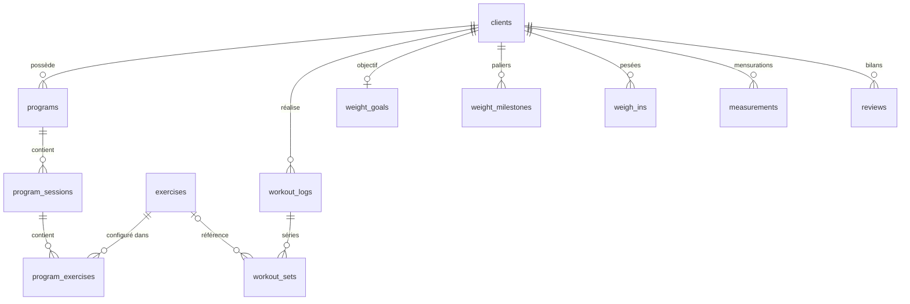

# Victor Training

Application web **privée** de gestion de coaching sportif : clients, programmes de musculation personnalisés, bibliothèque d'exercices, suivi des performances (charges, répétitions, RPE, RIR, 1RM estimé) et suivi de perte de poids (pesées, objectifs, mensurations, bilans, PDF).

> Outil de travail réservé au coach : aucune inscription publique, aucune page commerciale, aucun espace client.

---

## Sommaire

1. [Fonctionnalités](#1-fonctionnalités)
2. [Technologies](#2-technologies)
3. [Architecture des fichiers](#3-architecture-des-fichiers)
4. [Base de données](#4-base-de-données)
5. [Sécurité](#5-sécurité)
6. [Installation locale](#6-installation-locale)
7. [Configuration de Supabase](#7-configuration-de-supabase)
8. [Création du compte administrateur](#8-création-du-compte-administrateur)
9. [Publication sur GitHub](#9-publication-sur-github)
10. [Déploiement sur Vercel](#10-déploiement-sur-vercel)
11. [Sauvegarde et restauration](#11-sauvegarde-et-restauration)
12. [Utilisation au quotidien](#12-utilisation-au-quotidien)
13. [Dépannage](#13-dépannage)

---

## 1. Fonctionnalités

| Module | Contenu |
|---|---|
| **Connexion** | E-mail + mot de passe, sessions sécurisées, déconnexion, mot de passe oublié, aucune inscription publique |
| **Tableau de bord** | Clients actifs, programmes, séances du mois, suivis de poids, programmes récemment modifiés, clients récemment ajoutés, dernières séances, raccourcis, recherche rapide |
| **Mes clients** | Fiche complète (objectif, niveau, séances/semaine, contraintes, notes privées), recherche, archivage, suppression confirmée. Onglets : Informations · Programmes · Historique des séances · Progression sportive · Perte de poids · Mensurations · Bilans |
| **Programmes** | Création depuis 9 modèles (Full Body, Upper/Lower, Push/Pull/Legs, Half Body, Split, Force, Hypertrophie, Haltérophilie, Personnalisé) ou depuis un programme existant ; séances libres (Séance A, Jour 1…) ; **glisser-déposer** des exercices ; copie de séance ; duplication ; réassignation à un autre client ; modèles réutilisables ; archivage ; filtres |
| **Paramètres d'exercice** | Séries, répétitions ou plage, charge (kg), RPE cible, RIR cible, repos, tempo, type de série, consignes techniques, commentaire — tous facultatifs, propres à chaque programme |
| **Bibliothèque d'exercices** | Fiches réutilisables (muscle, matériel, type de mouvement, description, consignes, erreurs fréquentes, variantes, lien vidéo, notes) ; filtres ; import d'une bibliothèque de base (~45 exercices) |
| **Suivi des séances** | Saisie des séries réellement réalisées (charge, reps, RPE, RIR, repos, commentaire) avec rappel du **prévu** et de la **dernière performance** ; modification et suppression |
| **Progression** | Graphique par exercice (charge max, 1RM estimé, volume, répétitions), records, dernière performance, comparaison de deux séances |
| **Perte de poids** | Poids de départ / actuel / objectif, évolution totale et depuis la pesée précédente, barre de progression, objectifs intermédiaires, date cible, graphique, historique, comparaison de dates |
| **Mensurations** | Taille, hanches, poitrine, cuisse, bras (toutes facultatives), graphiques, comparaison de périodes |
| **Bilans périodiques** | Poids, évolution depuis le bilan précédent et des mensurations (calculées), difficultés, points positifs, commentaires, objectifs suivants |
| **Exports PDF** | Programme et bilan de perte de poids, en **A4 imprimable** et en **format smartphone** |
| **Recherche globale** | Clients, programmes, exercices, séances et performances (`Ctrl K`) |

**Principes respectés**
- Modifier un exercice dans un programme ne modifie jamais les autres programmes (fiche générale ≠ configuration par programme).
- Modifier ou supprimer un programme n'efface jamais les séances réalisées (les noms sont conservés dans l'historique).
- Aucune mesure n'est inventée : graphiques et calculs reposent uniquement sur les valeurs saisies, aucune projection de perte de poids n'est affichée.
- Les calculs restent cohérents si le client dépasse l'objectif, reprend du poids, vise une prise de poids ou change d'objectif.

---

## 2. Technologies

| Rôle | Choix |
|---|---|
| Framework | Next.js 15 (App Router) + TypeScript |
| Interface | Tailwind CSS, icônes Lucide, polices Inter et Barlow Condensed (auto-hébergées) |
| Base de données | PostgreSQL via Supabase |
| Authentification | Supabase Auth (`@supabase/ssr`, cookies HTTP) |
| Graphiques | Recharts |
| Glisser-déposer | dnd-kit (souris, tactile et clavier) |
| PDF | jsPDF + jspdf-autotable (génération dans le navigateur) |
| Hébergement | Vercel · Code source : GitHub |

---

## 3. Architecture des fichiers

```
geoffroy-fitness-training/
├── src/
│   ├── middleware.ts                 # Protection de toutes les routes privées
│   ├── app/
│   │   ├── login/ forgot-password/ reset-password/
│   │   ├── auth/callback/route.ts    # Lien e-mail → session
│   │   ├── auth/signout/route.ts     # Déconnexion (POST)
│   │   └── (app)/                    # Espace privé (vérification serveur dans layout.tsx)
│   │       ├── dashboard/            # Tableau de bord
│   │       ├── clients/ [id]/        # Liste + fiche client à onglets
│   │       ├── programs/ [id]/       # Liste + éditeur de programme
│   │       ├── exercises/            # Bibliothèque
│   │       ├── weight/               # Suivi de perte de poids
│   │       ├── sessions/new, [id]/   # Saisie / modification d'une séance réalisée
│   │       └── search/               # Recherche globale
│   ├── components/
│   │   ├── ui.tsx                    # Boutons, champs, cartes, modale, confirmation, onglets…
│   │   ├── toast.tsx                 # Messages de succès / erreur
│   │   ├── AppShell.tsx              # Barre latérale, barre mobile, recherche
│   │   ├── ClientForm, ProgramForm, ExerciseForm, ExercisePicker
│   │   ├── WorkoutEditor.tsx         # Saisie prévu / réalisé
│   │   ├── TrainingPanels.tsx        # Historique + progression sportive
│   │   ├── WeightTracker.tsx         # Pesées, objectifs, graphique
│   │   ├── MeasurementsPanel.tsx     # Mensurations
│   │   ├── ReviewsPanel.tsx          # Bilans
│   │   └── charts.tsx
│   └── lib/
│       ├── supabase/                 # Clients navigateur et serveur
│       ├── calc.ts                   # 1RM, résumé de poids, mensurations, agrégats
│       ├── data.ts                   # Modèles, duplication, copie de séance
│       ├── pdf.ts                    # Exports PDF (A4 et mobile)
│       ├── starter.ts                # Bibliothèque de base et modèles de programmes
│       ├── format.ts                 # Formats français, libellés, validation
│       └── types.ts
├── supabase/
│   ├── migrations/
│   │   ├── 20261012000001_schema.sql     # Tables, contraintes, index, triggers
│   │   └── 20261012000002_security.sql   # Row Level Security + contrôles de propriété
│   └── seed_admin.sql                     # Requêtes de vérification
├── scripts/backup.sh · scripts/restore.sh
├── .env.example
└── README.md
```

---

## 4. Base de données



| Table | Rôle |
|---|---|
| `clients` | Fiches clients (archivage par `archived`) |
| `exercises` | Fiche générale d'un exercice (bibliothèque) |
| `programs` | Programme (client facultatif ; `is_template` pour les modèles ; `archived`) |
| `program_sessions` | Séances d'un programme, ordonnées par `position` |
| `program_exercises` | **Configuration propre au programme** : séries, reps, charge, RPE, RIR, repos, tempo, type, consignes |
| `workout_logs` | Séance réalisée (date, programme et séance d'origine, noms copiés, commentaires) |
| `workout_sets` | Séries réalisées + valeurs prévues copiées au moment de la saisie |
| `weight_goals` | Poids de départ, objectif, dates (1 par client) |
| `weight_milestones` | Objectifs intermédiaires |
| `weigh_ins` | Pesées réellement effectuées |
| `measurements` | Mensurations datées (au moins une valeur) |
| `reviews` | Bilans périodiques |

**Protection de l'historique**
- Supprimer un programme : `workout_logs.program_id` passe à `NULL`, la séance réalisée reste (avec le nom du programme et de la séance).
- Supprimer un exercice utilisé dans un programme est **refusé** (`ON DELETE RESTRICT`) ; s'il n'est utilisé que dans l'historique, les séries conservent son nom.
- Supprimer un client supprime l'ensemble de ses données (action irréversible, double confirmation) — l'**archivage** est proposé en alternative.

---

## 5. Sécurité

- **Aucune page privée accessible sans connexion** : vérification dans le middleware (`supabase.auth.getUser()`, validée auprès du serveur d'authentification) **et** dans le layout serveur de l'espace privé.
- **Row Level Security** activée et forcée sur les 12 tables : chaque ligne porte un `coach_id` (rempli automatiquement avec `auth.uid()`) et n'est lisible / modifiable que par son propriétaire. Le rôle `anon` n'a aucun droit.
- **Triggers de cohérence** : impossible de rattacher une donnée à un client, programme ou séance appartenant à un autre compte.
- **Validation** côté interface et **contraintes SQL** côté base (longueurs, plages de valeurs : RPE 1–10, RIR 0–10, poids 20–400 kg, URL vidéo en http(s)…).
- **Aucune clé secrète dans le code** : seules l'URL et la clé publique `anon` sont utilisées par l'application (la clé `service_role` n'est jamais nécessaire).
- **En-têtes HTTP** de sécurité (`X-Frame-Options`, `nosniff`, `Referrer-Policy`…), pages non indexées (`noindex`, `robots.txt`).
- **RGPD** : seules les informations nécessaires au coaching sont collectées ; pas de date de naissance, d'adresse ni de téléphone ; suppression complète possible ; données hébergées dans la région Supabase choisie (privilégier l'UE).

> Pensez à **désactiver les inscriptions** dans Supabase (étape 7.3) : c'est ce qui garantit qu'aucun autre compte ne peut être créé.

---

## 6. Installation locale

Prérequis : **Node.js 20+** et un projet Supabase (gratuit).

```bash
git clone https://github.com/<votre-compte>/geoffroy-fitness-training.git
cd geoffroy-fitness-training
npm install
cp .env.example .env.local      # puis renseignez les valeurs
npm run dev                     # http://localhost:3000
```

Variables d'environnement (`.env.local`) :

| Variable | Où la trouver |
|---|---|
| `NEXT_PUBLIC_SUPABASE_URL` | Supabase › Project Settings › API › Project URL |
| `NEXT_PUBLIC_SUPABASE_ANON_KEY` | Supabase › Project Settings › API › `anon` `public` |
| `NEXT_PUBLIC_SITE_URL` | `http://localhost:3000` en local, l'URL Vercel en production |
| `SUPABASE_DB_URL` | *(sauvegardes uniquement)* Project Settings › Database › Connection string (URI, mode Session) |

---

## 7. Configuration de Supabase

### 7.1 Créer le projet
1. [supabase.com](https://supabase.com) › **New project**.
2. Région : **West EU (Paris)** ou **Central EU (Frankfurt)** (RGPD).
3. Notez le mot de passe de la base dans un gestionnaire de mots de passe.

### 7.2 Créer les tables et la sécurité
**Option A — éditeur SQL (le plus simple)**
1. Supabase › **SQL Editor** › **New query**.
2. Collez le contenu de `supabase/migrations/20261012000001_schema.sql` › **Run**.
3. Nouvelle requête : collez `supabase/migrations/20261012000002_security.sql` › **Run**.

**Option B — Supabase CLI**
```bash
npx supabase login
npx supabase link --project-ref <ref-du-projet>
npx supabase db push
```

### 7.3 Paramètres d'authentification
Dans **Authentication** :
1. **Sign In / Providers** › *Allow new users to sign up* : **désactivé**.
2. **Sign In / Providers** › Email : activé ; *Confirm email* peut rester activé.
3. **URL Configuration** :
   - *Site URL* : `https://<votre-app>.vercel.app`
   - *Redirect URLs* : `https://<votre-app>.vercel.app/**` et `http://localhost:3000/**`
4. *(Recommandé)* **Attack Protection** : activer la protection contre les mots de passe compromis ; longueur minimale ≥ 10.

---

## 8. Création du compte administrateur

1. Supabase › **Authentication** › **Users** › **Add user** › **Create new user**.
2. Saisissez votre e-mail et un mot de passe robuste (≥ 12 caractères), cochez **Auto Confirm User**.
3. Connectez-vous sur l'application avec ces identifiants.
4. Première utilisation conseillée : **Bibliothèque d'exercices › Bibliothèque de base** pour importer ~45 exercices modifiables.

Changer de mot de passe : page de connexion › *Mot de passe oublié ?* (un lien est envoyé par e-mail ; ouvrez-le dans le même navigateur).

> Les inscriptions étant désactivées, ce compte est le seul. Toutes les données lui appartiennent (`coach_id`).

---

## 9. Publication sur GitHub

```bash
cd geoffroy-fitness-training
git init
git add .
git commit -m "Geoffroy Fitness Training — version initiale"
git branch -M main
git remote add origin https://github.com/<votre-compte>/geoffroy-fitness-training.git
git push -u origin main
```

- Créez le dépôt en **Private** sur GitHub (New repository › Private, sans README).
- Vérifiez que `.env.local` **n'apparaît pas** dans le dépôt (il est exclu par `.gitignore`).
- Les données clients ne sont jamais dans GitHub : elles restent dans Supabase. Le dossier `backups/` est également exclu.

---

## 10. Déploiement sur Vercel

1. [vercel.com](https://vercel.com) › **Add New… › Project** › importez le dépôt GitHub.
2. Framework détecté : **Next.js** (aucun réglage de build à modifier).
3. **Environment Variables** :
   - `NEXT_PUBLIC_SUPABASE_URL`
   - `NEXT_PUBLIC_SUPABASE_ANON_KEY`
   - `NEXT_PUBLIC_SITE_URL` = `https://<votre-app>.vercel.app`
   *(ne mettez pas `SUPABASE_DB_URL` sur Vercel : elle ne sert qu'aux sauvegardes locales)*
4. **Deploy**.
5. Reportez l'URL finale dans Supabase › Authentication › URL Configuration (étape 7.3).
6. Sur smartphone : ouvrez l'URL puis *Partager › Sur l'écran d'accueil* (iPhone) ou *Ajouter à l'écran d'accueil* (Android) pour un accès en un geste.

Chaque `git push` sur `main` redéploie automatiquement l'application.

---

## 11. Sauvegarde et restauration

### Sauvegardes automatiques Supabase
- Plan **Pro** : sauvegardes quotidiennes automatiques (Database › Backups), restauration en un clic.
- Plan **gratuit** : pas de sauvegarde automatique exploitable → utilisez la procédure ci-dessous **au moins une fois par semaine**.

### Sauvegarde manuelle (toutes les données)
Prérequis : outils PostgreSQL (`pg_dump`, `pg_restore`, `psql`) version 15 ou plus.
- macOS : `brew install libpq && brew link --force libpq`
- Windows : installeur PostgreSQL (cocher « Command Line Tools ») ou WSL.

```bash
# SUPABASE_DB_URL renseignée dans .env.local
npm run backup
# → backups/gft_AAAA-MM-JJ_HHMMSS.dump
```

Stockez le fichier dans un emplacement **privé et chiffré** (il contient des données personnelles). Conservez plusieurs versions (ex. 4 dernières semaines + 1 par mois).

### Restauration
```bash
npm run restore -- backups/gft_AAAA-MM-JJ_HHMMSS.dump
```
Le script :
1. demande de taper `RESTAURER` pour confirmer ;
2. crée automatiquement une sauvegarde de sécurité de l'état actuel (`backups/avant-restauration_…`) ;
3. remplace toutes les données dans **une seule transaction** (tout ou rien : en cas d'erreur, rien n'est modifié).

### Reconstruire sur un nouveau projet Supabase
1. Exécutez les deux migrations (étape 7.2) sur le nouveau projet.
2. Créez le compte coach **avec la même adresse e-mail**, puis récupérez son identifiant : `select id from auth.users;`.
3. Restaurez la sauvegarde (`npm run restore`) en pointant `SUPABASE_DB_URL` vers le nouveau projet.
4. Si l'identifiant du compte a changé, réattribuez les données (SQL Editor) :
   ```sql
   do $$
   declare old_id uuid := '<ancien-id>'; new_id uuid := '<nouvel-id>'; t text;
   begin
     foreach t in array array['clients','exercises','programs','program_sessions','program_exercises',
       'workout_logs','workout_sets','weight_goals','weight_milestones','weigh_ins','measurements','reviews'] loop
       execute format('update public.%I set coach_id = %L where coach_id = %L', t, new_id, old_id);
     end loop;
   end $$;
   ```
5. Mettez à jour les variables d'environnement sur Vercel puis redéployez.

---

## 12. Utilisation au quotidien

1. **Nouveau client** : *Mes clients › Nouveau client*.
2. **Programme** : depuis la fiche client › *Programmes › Nouveau programme* › choisir un modèle (ou un programme existant) › ajuster.
   - Toucher un exercice pour définir séries, reps, charge, RPE, RIR, repos, tempo, consignes.
   - Poignée ⋮⋮ pour réordonner (glisser-déposer, aussi au doigt).
   - Icônes de séance : monter / descendre, copier, note, supprimer.
3. **PDF** : bouton *PDF* (impression A4) ou *PDF mobile* (lecture sur téléphone) à transmettre au client.
4. **Après une séance** : *Saisir une séance* › choisir la séance prévue : les exercices et objectifs sont pré-remplis, la dernière performance est rappelée ; saisir les charges et répétitions réellement réalisées.
5. **Perte de poids** : onglet *Perte de poids* de la fiche (ou menu *Suivi de perte de poids*) › définir l'objectif › ajouter les pesées › *Bilan PDF*.
6. **Bilan périodique** : onglet *Bilans* › *Nouveau bilan* (poids et évolutions calculés automatiquement).

**Notes sur les calculs**
- **1RM estimé** : formule d'Epley `charge × (1 + reps / 30)`, calculée seulement jusqu'à 12 répétitions, à titre indicatif ; les séries d'échauffement sont exclues.
- **Progression vers l'objectif** : `(départ − actuel) / (départ − objectif)`. Au-delà de 100 % l'objectif est « atteint et dépassé » ; en dessous de 0 % l'évolution est signalée comme « inverse à l'objectif ».
- **Poids de départ** : celui de l'objectif s'il est renseigné, sinon la première pesée.

---

## 13. Dépannage

| Problème | Solution |
|---|---|
| « Identifiants incorrects » | Vérifiez l'utilisateur dans Supabase › Authentication › Users (statut *Confirmed*). |
| Redirection en boucle vers `/login` | Variables `NEXT_PUBLIC_SUPABASE_*` absentes ou erronées sur Vercel ; redéployez après correction. |
| Lien « mot de passe oublié » invalide | Ajoutez `https://<votre-app>.vercel.app/**` aux *Redirect URLs* ; ouvrez le lien dans le même navigateur que la demande. |
| « permission denied » / données invisibles | La migration `…_security.sql` n'a pas été exécutée, ou vous êtes connecté avec un autre compte. |
| Impossible de supprimer un exercice | Il est encore utilisé dans un programme : retirez-le ou remplacez-le d'abord. |
| `pg_dump: server version mismatch` | Installez une version de `pg_dump` ≥ celle du serveur Supabase. |

---

### Commandes utiles

```bash
npm run dev         # développement
npm run build       # compilation de production
npm run typecheck   # vérification TypeScript
npm run backup      # sauvegarde des données
npm run restore -- <fichier.dump>
```

---

## 14. Espace client (accès personnel de chaque client)

Chaque client peut recevoir un accès à **son** espace, sur la même adresse que l'application :
- il voit **uniquement** ses programmes et ses séances (jamais les autres clients, ni vos notes privées, contraintes, pesées ou bilans) ;
- il peut ajuster son programme (séries, répétitions, charges, ordre, exercices de votre bibliothèque) ;
- il peut noter ses séances (avec le chrono de repos) et suivre sa progression ;
- il peut exporter son programme en PDF ;
- vous gardez un accès complet en parallèle et voyez toutes ses modifications.

### Activation (une seule fois)
1. **Supabase › SQL Editor** : exécutez `supabase/migrations/20261013000003_client_accounts.sql`.
2. **Supabase › Project Settings › API Keys** : copiez la clé **secrète** (`sb_secret_…` ou `service_role`).
3. **Vercel › Settings › Environment Variables** : ajoutez `SUPABASE_SERVICE_ROLE_KEY` = cette clé (**sans** `NEXT_PUBLIC_` : elle reste côté serveur), puis **Redeploy**.
4. Vérifiez sur `/diagnostic` : la ligne « Accès clients » doit être verte.

### Utilisation
Fiche client › onglet **Informations** › carte **Accès client** : saisissez l'e-mail, cliquez sur **Générer** (ou choisissez un mot de passe), puis **Créer l'accès**. Les identifiants s'affichent une fois, avec un bouton **Envoyer par e-mail** (message prérempli) et **Copier le message**. Depuis la même carte : changer le mot de passe ou retirer l'accès (les données sont conservées).

> Les « notes personnelles » des fiches d'exercices sont visibles par les clients ayant un accès (elles servent aussi d'explications).

---

## 15. Exercices cardio

Tout exercice dont le **type de mouvement** (ou le groupe musculaire) est « Cardio » passe en mode cardio :
- **Programme** : durée (ex. `30`, `32:30`, `1h15`), distance (km), intensité libre (zone, allure, vitesse, % FC max…), **FC cible** (ex. `130-150`), RPE, nombre de blocs et récupération. Un bouton « Musculation / Cardio » permet de basculer pour n'importe quel exercice.
- **Séance réalisée** : par bloc, durée, distance, intensité, **FC moyenne**, **FC max** et RPE, avec rappel du prévu et de la dernière fois.
- **Progression** : durée totale, distance totale, FC moyenne et allure (min/km), records et comparaison de deux séances.
- **PDF** : les objectifs cardio apparaissent sur la ligne de l'exercice.

Activation : exécutez `supabase/migrations/20261014000004_cardio.sql` dans Supabase › SQL Editor, puis cliquez sur **Bibliothèque de base** dans la bibliothèque d'exercices pour ajouter les exercices cardio (course, vélo, rameur, elliptique, SkiErg…). Un modèle de programme **Cardio / Endurance** est disponible.

